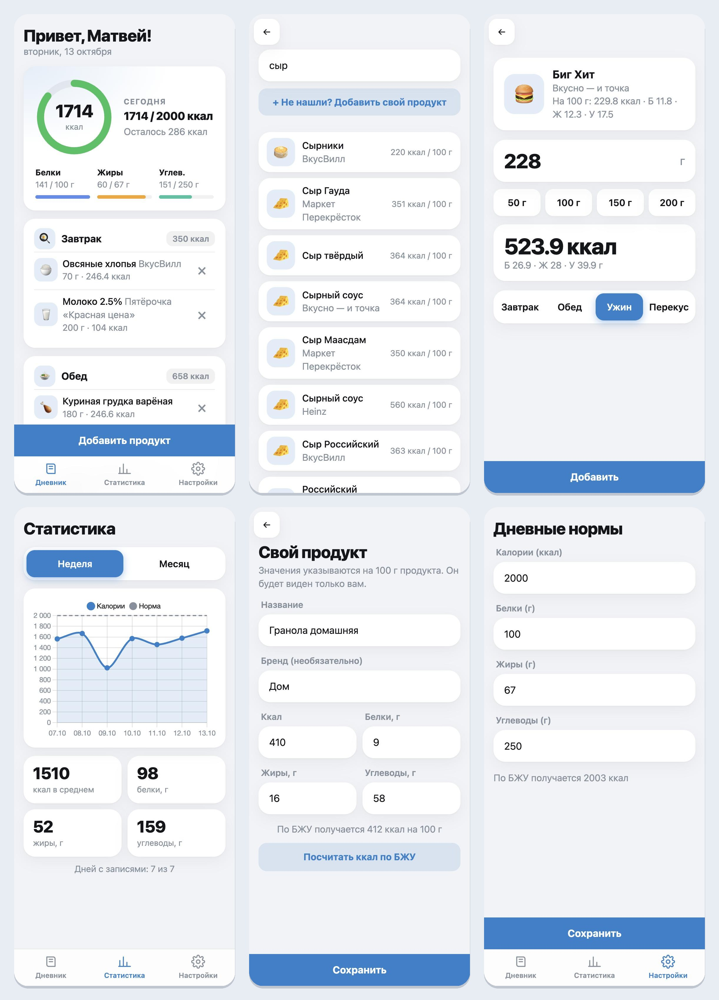
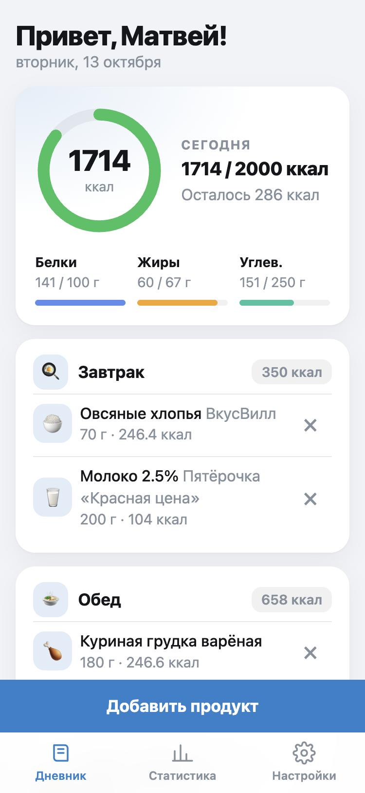
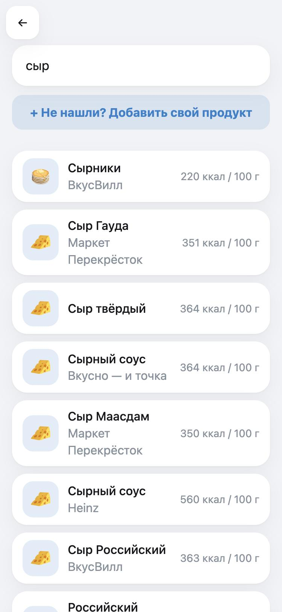
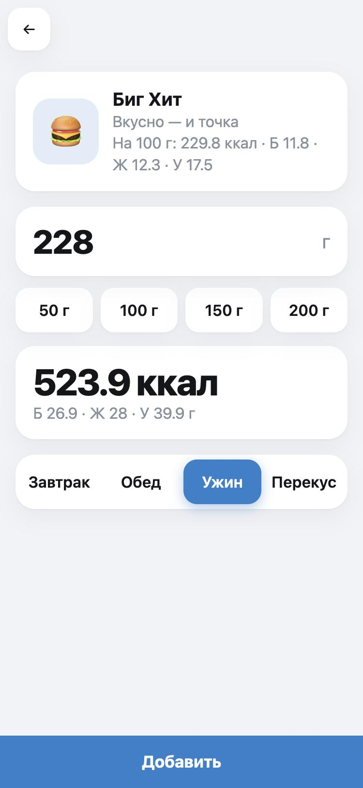
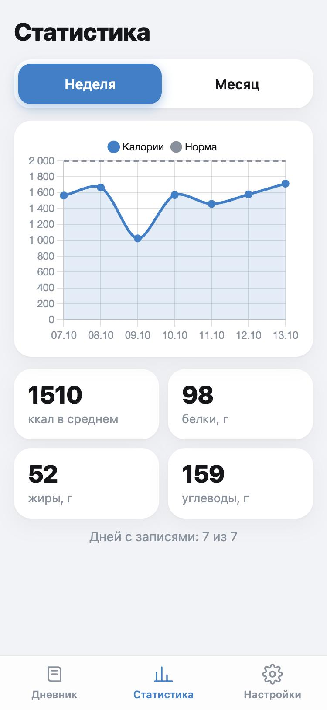
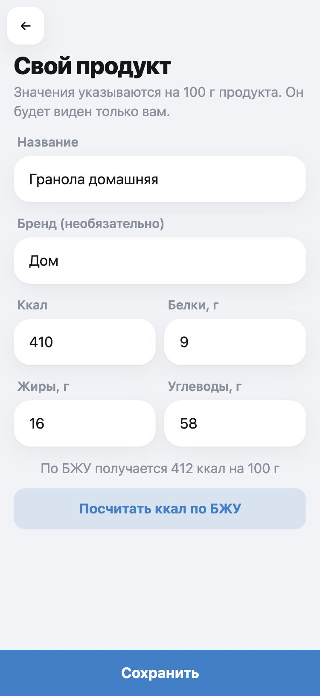
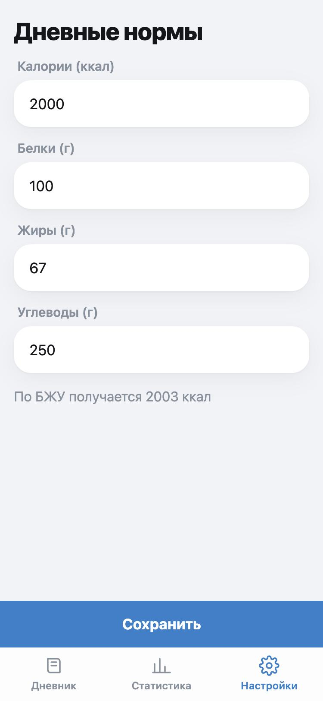

# CalorieBot — Telegram Mini App

[](https://github.com/siosif963-gif/caloriebot/actions/workflows/tests.yml)

## О проекте

CalorieBot — Telegram Mini App для ежедневного дневника питания. Пользователь находит продукт (по названию или штрихкоду), вводит вес порции и приём пищи, а приложение считает калории и БЖУ и показывает прогресс к дневной норме. Поиск комбинированный: сначала локальная база российских продуктов, затем OpenFoodFacts с сохранением найденного в локальную БД.

Стек: FastAPI + SQLAlchemy 2.0 + SQLite (бэкенд), Vanilla JS + Chart.js (фронтенд на GitHub Pages).

## Демо

Бот в Telegram: [@easyeatcounter_bot](https://t.me/easyeatcounter_bot) (кнопка меню открывает мини-апп).

> **Важно:** бот может не отвечать. Бэкенд работал на пробном периоде хостинга (Railway), поэтому после его окончания приложение может быть недоступно. Как оно выглядит, показано на скриншотах ниже.

## Скриншоты



| Дневник | Поиск | Порция |
|:---:|:---:|:---:|
|  |  |  |

| Статистика | Свой продукт | Настройки |
|:---:|:---:|:---:|
|  |  |  |

## Возможности

- Дневник питания по приёмам пищи: калории и БЖУ с прогрессом к дневной норме.
- Умный поиск по названию и штрихкоду: локальная база (сети общепита, магазины, базовые продукты) и OpenFoodFacts.
- Свои продукты: создание, видны только автору; проверка БЖУ на 100 г.
- Статистика за неделю и месяц с графиком и средними значениями.
- Авторизация через подпись Telegram `initData`, тема Telegram (светлая и тёмная).

## Локальный запуск бэкенда

```bash
cd backend
python -m venv .venv
source .venv/bin/activate
pip install -r requirements.txt
cp .env.example .env
```

В `backend/.env` задайте `DEV_MODE=true` и `FRONTEND_ORIGINS=http://localhost:5500`, затем запустите из папки `backend`:

```bash
uvicorn main:app --reload
```

Проверка: http://localhost:8000/api/health и http://localhost:8000/docs.

## Локальный запуск фронтенда

Временно поставьте в `frontend/api.js` `API_BASE_URL = 'http://localhost:8000'`, затем в папке `frontend`:

```bash
python -m http.server 5500
```

Откройте http://localhost:5500. Вне Telegram приложение работает только при `DEV_MODE=true` на бэкенде.

## Создание бота

В @BotFather: `/newbot`, сохраните токен. Затем `/mybots` → ваш бот → Bot Settings → Menu Button → укажите URL фронтенда на GitHub Pages.

## Деплой бэкенда на Railway

1. New Project → Deploy from GitHub repo.
2. Root Directory: `backend`.
3. Добавьте Volume с точкой монтирования `/data`.
4. Переменные окружения — из `.env.example` (`DATABASE_URL=sqlite:////data/database.db`, `DEV_MODE=false`, `BOT_TOKEN`, `FRONTEND_ORIGINS`).
5. Start Command: `uvicorn main:app --host 0.0.0.0 --port $PORT`.
6. Generate Domain.

Альтернатива — Render: Web Service, Root Directory `backend`, Build: `pip install -r requirements.txt`, Start: та же команда. Для сохранности данных нужен Persistent Disk на `/data` (платный тариф). Предупреждение: без диска база стирается при каждом деплое, а бесплатный сервис засыпает и первый запрос может идти до минуты.

## Деплой фронтенда

1. Впишите домен бэкенда в `API_BASE_URL` в `frontend/api.js`.
2. В настройках репозитория: Settings → Pages → Source: GitHub Actions.
3. Сделайте push в `main`.
4. Адрес вида `https://username.github.io/caloriebot/` добавьте в Menu Button бота, а origin `https://username.github.io` — в `FRONTEND_ORIGINS` бэкенда.

## Частые проблемы

- **Ошибка CORS** — проверьте `FRONTEND_ORIGINS` (только origin, без пути).
- **401** — приложение открыто не через Telegram или неверный `BOT_TOKEN`.
- **Пропали данные** — не подключён Volume / Disk.
